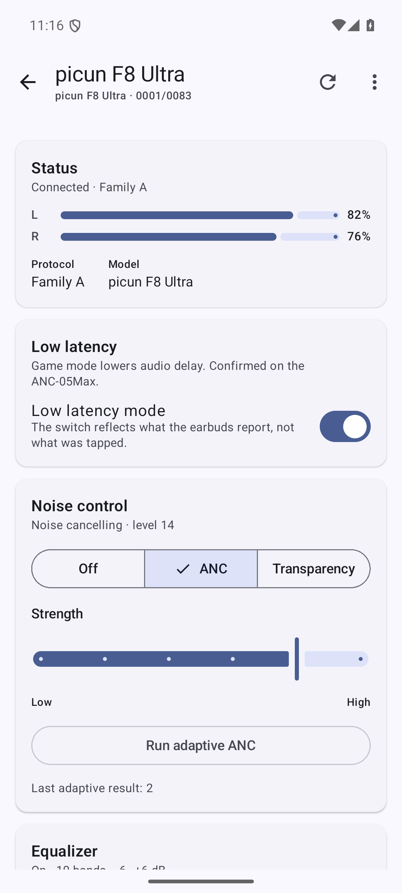
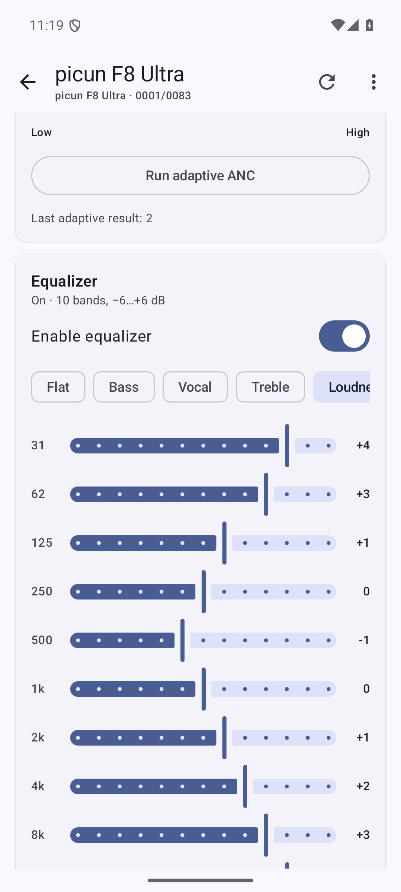

# Picun Control

An unofficial, offline, native Android app for Picun earbuds and headphones. It replaces the
official **Picun Audio** uni-app with a small Kotlin/Jetpack Compose app that talks to the earbuds
directly over Bluetooth LE.

No account. No internet permission. No location permission on Android 12+. No analytics, ads or
crash reporting. The model catalogue is bundled in the APK.

> Picun Control is not affiliated with Picun. “Picun” is used only to describe compatibility.




## Features

- **Low latency / game mode** — the first feature confirmed on real hardware (ANC-05Max).
- **Noise control** — off, ANC and transparency, with family-A strength levels and adaptive ANC.
- **10-band equalizer** — 31 Hz…16 kHz, −6…+6 dB, built-in and locally saved presets.
- **Battery** — left/right percentages when the earbuds report them.
- **Volume**, play/pause/next/previous, spatial audio, prompt language.
- **Find my earbuds**, mic mode, volume limit, leak-proof sound mode.
- **Model-specific extras** — RGB light, heating, head tracking, touch controls, wear detection,
  wind-noise reduction, LDAC, bass boost, sleep mode.
- **Model database** — the public Picun catalogue (112 products) decides which cards to show.
  Unknown models stay read-only until the user opts into experimental controls.
- **Diagnostics** — CRC-checked raw hex log, protocol detection, and read-only probes for every
  command, so users can map new models and report results.
- **Safety** — every incoming packet is length- and CRC-validated; destructive commands (rename,
  clear pairing, factory reset) are behind explicit confirmation dialogs.

## Supported hardware

The protocol covers two framing families:

| Family | Products | Status |
|---|---|---|
| A (`FC FA`) | `device_model 0001` — ANC-05Max, F6, F8, NC60, W3, H-series, most of the catalogue | Game mode verified on ANC-05Max; other controls implemented from the protocol and awaiting hardware confirmation |
| B (`AN03`) | `device_model 01` — F2 | Implemented from the reverse-engineered protocol; **no hardware test yet** |

The ANC-05Max is delisted from Picun's catalogue, which is why newer official app versions no
longer show it. The BLE service is still there.

## Install

- **APK:** build it yourself with the instructions below (debug or release).
- **F-Droid:** metadata is included under `fastlane/`; publication is pending.

## Build

Requirements: JDK 17+, Android SDK with API 37.

```bash
./gradlew testDebugUnitTest assembleDebug
# debug APK: app/build/outputs/apk/debug/app-debug.apk
```

No `local.properties` is committed; point `sdk.dir` at your Android SDK.

## How it works

```
app/src/main/kotlin/io/github/picuncontrol/
  protocol/   Protocol.kt   frame builders, CRC-8/MAXIM and CRC-16/ARC, validated parser
              Commands.kt   typed command table (both families)
              Replies.kt    tolerant reply decoders
              Advertisement.kt  manufacturer-data → family / product IDs
  ble/        PicunConnection.kt  scan, GATT connect, notify, op queue, reconnect
  model/      bundled catalogue, feature gating, family filtering
  data/       local preferences and custom EQ presets
  ui/         Compose screens, cards and the session ViewModel
```

Design rules:

- `Protocol`/`Commands`/`Replies` are pure Kotlin and unit-tested against known byte vectors.
- UI state comes from earbud replies, not optimistic taps (EQ editing is a local draft).
- Writes are serialized with a gap and retried; incoming packets with a bad CRC are dropped.
- The app has **no network permission**. The catalogue and all presets live on the phone.

The protocol was reverse-engineered from the official app's JavaScript bundle. The detailed
reverse-engineering notes are kept outside the published repository.

### Protocol verification status

Only two things are confirmed by ear on real ANC-05Max hardware: the BLE service/characteristics
and the game-mode toggle (`FC FA 01 78 01 D8` / `FC FA 01 78 00 86`). Everything else is
implemented from the official app's JavaScript and is still unverified. The Diagnostics screen
exists to change that: connect a model, tap the probes, and record the raw replies.

## Privacy

- No `INTERNET` permission in the merged manifest.
- No account, login, cloud sync or server calls at runtime.
- No location permission on Android 12+ (`BLUETOOTH_SCAN` is declared with `neverForLocation`).
- Android 11 and older still require location permission for any BLE scan; the app never reads or
  stores location.
- Local presets are stored in app-private `SharedPreferences`; Android backup is disabled.
- Optional “find my earbuds” is a beep on the earbuds, not a location log.

## Development

```bash
./gradlew testDebugUnitTest     # protocol vectors, parser, model catalogue
./gradlew assembleDebug
```

A debug-only UI preview is available without hardware:

```bash
adb shell am start -n io.github.picuncontrol/.MainActivity --ez demo true
```

It fills the screens with sample values and sends no BLE traffic. Release builds ignore the extra.

## License

GPL-3.0-only. See [`LICENSE`](LICENSE).
